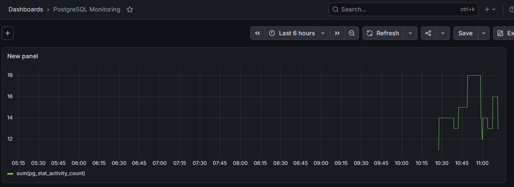

# Grafana + Prometheus: PostgreSQL Monitoring

Pet-проект по настройке мониторинга и observability для базы данных PostgreSQL.

## 🎯 Бизнес-задача:
Настроить сбор и визуализацию технических метрик базы данных (количество активных подключений, нагрузка) для оперативного выявления проблем (например, перегрузки из-за ETL-процессов).

## 🛠 Стек:
- **Docker (docker-compose):** Развертывание инфраструктуры мониторинга.
- **postgres_exporter:** Сбор метрик с PostgreSQL.
- **Prometheus:** База данных временных рядов (Time Series DB).
- **Grafana:** Визуализация метрик и создание дашбордов.

## 📊 Результаты:
Настроен дашборд **«PostgreSQL Monitoring»**, который отображает **общее количество активных подключений** к базе данных в реальном времени. Это позволяет администраторам видеть «пульс» системы и вовремя реагировать на аномалии.

## 🚀 Как запустить (в Linux VM):
1. Установите Docker и Docker Compose.
2. Запустите инфраструктуру: `docker compose up -d`.
3. Откройте Grafana: `http://localhost:3000` (или тот порт, который вы пробросили).
4. Логин: `admin`, пароль: `admin`.
5. Подключите Prometheus как Data Source (`http://prometheus:9090`) и импортируйте дашборд (или создайте панель с запросом `sum(pg_stat_activity_count)`).

## 💡 Выводы:
Настроен полный цикл Data Observability: от сбора сырых метрик до визуализации. Это показывает навыки работы с инфраструктурой (DevOps/DataOps) и понимание того, как работает база данных «под капотом».
