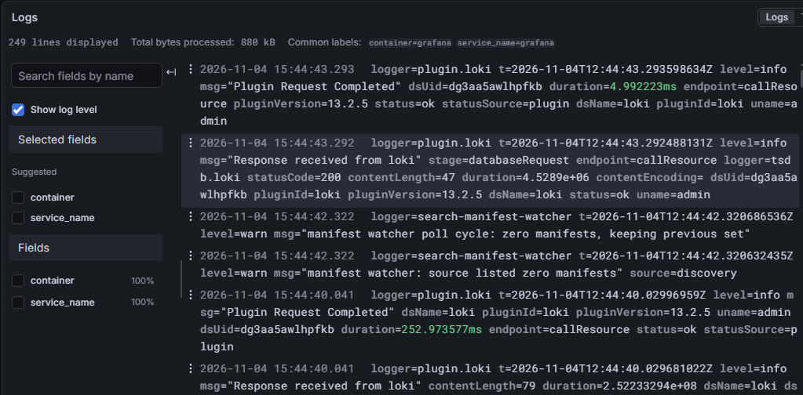

# Grafana + Prometheus + Loki: PostgreSQL Monitoring & Observability

Pet-проект по настройке мониторинга и observability для базы данных PostgreSQL и смежных сервисов.

## 🎯 Бизнес-задача:
Настроить сбор и визуализацию технических метрик (количество активных подключений, нагрузка) и логов для оперативного выявления проблем.

## 🛠 Стек:
- **Docker (docker-compose):** Развертывание инфраструктуры.
- **postgres_exporter:** Сбор метрик с PostgreSQL.
- **Prometheus:** База данных временных рядов (метрики).
- **Loki + Promtail:** Сбор и хранение логов (Log Aggregation).
- **Grafana:** Визуализация метрик и логов.

## 📊 Результаты:

1. **Дашборд «PostgreSQL Monitoring»:** Отображает общее количество активных подключений к базе данных в реальном времени.

*Дашборд метрик PostgreSQL (активные подключения)*

2. **Проводник логов (Explore):** Настроен сбор логов из Docker-контейнеров (через Promtail) и их поиск в Grafana. Видны логи уровня `info` и `warn` с указанием времени, контейнера и сообщения.

*Просмотр логов контейнера в Grafana (Loki + Promtail)*

## 🚀 Как запустить:
1. Установите Docker и Docker Compose.
2. Запустите инфраструктуру: `docker compose up -d`.
3. Откройте Grafana: `http://localhost:3000` (или ваш проброшенный порт).
4. Логин: `admin`, пароль: `admin`.
5. Подключите Prometheus (`http://prometheus:9090`) и Loki (`http://loki:3100`) как Data Sources.

## 💡 Выводы:
Настроен полный цикл Data Observability: от сбора метрик (Prometheus) до анализа логов (Loki). Это показывает навыки работы с инфраструктурой (DevOps/DataOps) и понимание того, как работает база данных «под капотом».
